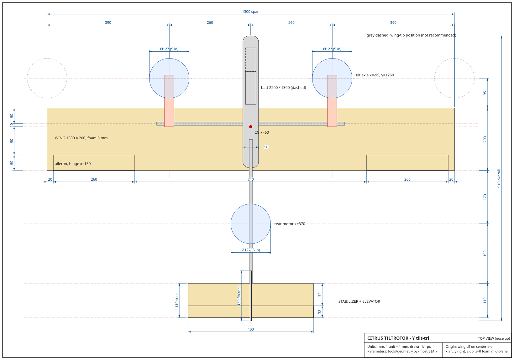
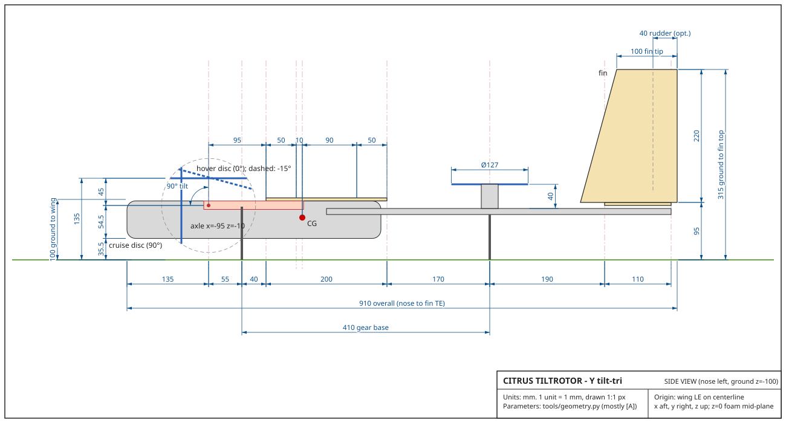

# Citrus Tiltrotor: airframe geometry

Y tilt-tri VTOL: 2 tilting front motors, 1 fixed rear lift motor on a boom, straight foam wing, conventional tail (flat stabilizer with elevator, fixed fin).

Every number in this document comes from `tools/geometry.py`. Run it and compare:

```
python3 -I tools/geometry.py          # print every number and check
python3 -I tools/geometry.py --svg    # also redraw docs/geometry-top.svg and docs/geometry-side.svg
```

All parameters sit at the top of the script. When you weigh a part or measure thrust, change the value there and run it again. The equations match `docs/design-guide.html`.

**Number tags:** **[M]** measured, **[C]** calculated, **[A]** assumed. Nothing is measured yet. The motor thrust (680 g), every part mass and every material property is **[A]**. Every derived number is **[C]** from those assumptions.




---

## 0. The headline: the tips do not work, so the nacelles move to y = ±260 mm

The brief put the front tilt rotors at the wing tips (y = ±650). I checked that layout first (section 7). It **fails structurally** with the planned wing, and it still fails with much bigger spars:

| Tip layout (y = ±650) with... | Tip deflection in hover | Twist at full thrust | 1st bending mode | 1st torsion mode | Verdict |
|---|---|---|---|---|---|
| 4 mm rod + foam (the plan) | 70 mm | 344° (meaning it would break) | 3.1 Hz | 1.8 Hz | FAIL |
| 10x8 carbon tube | 6 mm | 5.0° | 10.6 Hz | 15.4 Hz | FAIL |
| 12x10 carbon tube | 3 mm | 2.7° | 14.3 Hz | 20.7 Hz | FAIL (marginal) |

The cause is simple. A tip nacelle hangs a 65 g mass and up to 680 g of thrust at the end of a 625 mm cantilever. The thrust also acts 145 mm ahead of the spar, so it twists the wing. A 5 mm foam sheet has almost no depth, so it is very flexible in bending and in torsion. The flight controller would be fighting a wing that flaps and twists at 2 to 3 Hz, which is right inside its control bandwidth. That is a recipe for oscillation in hover, even before strength becomes a question. A tube stiff enough for the tips (14 mm class, about 80 g plus a joiner) cannot sit inside a 5 mm foam wing, and it costs T/W that you do not have (section 8).

**Recommended layout (used for everything below):** keep everything else from the brief, but mount the two tilt nacelles at **y = ±260 mm** (40 % of the semispan). Mount them on a **continuous 10x8 mm carbon centre tube** (600 mm long) that is clamped in the fuselage and runs under the wing at the 25 % chord line. The two 650 mm foam halves stay detachable: they clip onto that tube. Outboard of the tube, a 4 mm rod inside the foam carries the outer panel. With this layout every structural check passes, the ailerons sit in clean air, and the nacelle wiring never crosses the wing joint.

Why 260 and not 300: at y = 300 the 10x8 tube twists 2.2° at full thrust on one motor, just over the 2° limit. Moving in 40 mm shortens the twisting length and brings it to 1.9°.

---

## 1. Coordinate system and wing

- **Origin:** wing leading edge (LE) on the aircraft centerline. **x** points aft, **y** right, **z** up, all in mm. z = 0 is the mid-plane of the 5 mm foam wing, so the wing occupies z = −2.5 to +2.5.
- **Wing:** 1300 × 200 mm, rectangular. Area S = 26.0 dm², aspect ratio AR = b/c = 6.50 [C]. It is a shoulder wing: two 650 mm halves butt together at y = 0 on top of the fuselage pod.
- **Spar line:** x = 50 mm (25 % chord). The centre tube (10x8, y = −300…+300) is glued in printed clips under the lower surface, so its centre is at z = −7.5. A 4 mm carbon rod sits in a slot in the foam from y = 200 to 640 on each side. It overlaps the tube by 100 mm.
- **Ailerons:** y = 370…630 on each side, 50 mm chord (25 %), hinge at x = 150. Total area 2.60 dm² (10 % of S) [C]. Leave 20 mm of solid foam at the tip.
- **Airfoil:** round the LE, bevel the TE, and add roughly 3 to 4 % camber (6 to 8 mm of bow, highest at about x = 70) [A] by scoring the paper. Test the scoring on a scrap first: depending on your board, scoring the convex side or the concave side gives the cleaner bend.

---

## 2. Component placement and CG

The CG is a weighted average (guide, "CG & stability"):

  x_cg = Σ(m_i · x_i) / Σ m_i

Masses come from the BOM where it lists them, and are **[A]** otherwise. Positions are where the design puts each part. The battery is the trim mass: the script solves for the battery x that puts the CG on the target, then rounds it to 5 mm.

**CG target: x = 60 mm (30 % chord).** Two rules apply. Your brief asks for 25 to 30 % chord. The static-margin rule (5 to 15 %) allows x = 57…77 mm with this tail (section 3). The overlap of the two is 57 to 60 mm, so 60 mm leaves the most room on both.

### Placement table, 3S 2200 case

| Component | m (g) | x | y | m·x | Tag |
|---|---|---|---|---|---|
| Battery 3S 2200 | 190.0 | **−65** | 0 | −12350 | A (BOM) |
| Flight controller | 10.0 | 58 | 0 | 580 | A (BOM) |
| Receiver iA6B | 5.0 | −20 | 0 | −100 | A (BOM) |
| 3 × ESC 25 A (nose bay, shelf above the battery) | 30.0 | −110 | 0 | −3300 | A (BOM) |
| Wiring, BEC, connectors | 40.0 | 0 | 0 | 0 | A (BOM) |
| Front-left tilting group (motor, prop, yoke) | 42.0 | −95 | −260 | −3990 | A |
| Front-right tilting group | 42.0 | −95 | 260 | −3990 | A |
| Front-left tilt servo | 13.0 | −85 | −285 | −1105 | A (BOM) |
| Front-right tilt servo | 13.0 | −85 | 285 | −1105 | A (BOM) |
| Front-left pylon (PETG) | 10.0 | −20 | −260 | −200 | A |
| Front-right pylon (PETG) | 10.0 | −20 | 260 | −200 | A |
| Rear motor, prop, mount | 42.0 | 370 | 0 | 15540 | A |
| Aileron servo L | 9.0 | 110 | −500 | 990 | A (BOM) |
| Aileron servo R | 9.0 | 110 | 500 | 990 | A (BOM) |
| Elevator servo (in fuselage) | 9.0 | 150 | 0 | 1350 | A (BOM) |
| Elevator pushrod + guides | 4.0 | 360 | 0 | 1440 | A |
| Foam wing, 2 halves (incl. glue, tape) | 130.0 | 100 | 0 | 13000 | A (BOM) |
| Centre tube 10x8, 600 mm | 26.3 | 50 | 0 | 1315 | C |
| 2 × 4 mm rods, 880 mm total | 17.7 | 50 | 0 | 885 | C |
| Boom 10x8, 570 mm | 25.0 | 385 | 0 | 9617 | C |
| Fuselage pod (PLA) | 85.0 | −10 | 0 | −850 | A |
| Wing clips + root ribs (PLA) | 15.0 | 50 | 0 | 750 | A |
| Boom clamps (PETG) | 10.0 | 145 | 0 | 1450 | A |
| Tail mount: stab saddle + fin socket | 15.0 | 600 | 0 | 9000 | A |
| Landing legs, front pair (PETG) | 14.0 | −40 | ±260 | −560 | A |
| Landing leg, rear (PETG) | 6.0 | 370 | 0 | 2220 | A |
| Stabilizer + elevator (foam) | 17.6 | 615 | 0 | 10824 | C |
| Fin (foam) | 11.4 | 614 | 0 | 7022 | C |
| Horns, hinges, linkages | 6.0 | 300 | 0 | 1800 | A |
| Glue, tape, misc | 14.0 | 100 | 0 | 1400 | A |
| **Total** | **871.0** | | | **52423** | |

x_cg = 52423 / 871.0 = **60.2 mm = 30.1 % chord** [C]. y_cg = 0, because the layout is symmetric. z_cg is about −16 mm, below the wing, which helps cruise stability.

The foam tail is costed at 0.40 kg/m² [A] for bare 5 mm board. Weigh one 508 × 762 sheet and divide by 0.387 m² to get your real figure.

### Both battery cases

| Case | AUW | Battery centre x | x_cg |
|---|---|---|---|
| 3S 2200 (190 g) | **871 g** | −65 | 60.2 mm (30.1 %) |
| 3S 1300 (110 g) | **791 g** | −155 | 60.3 mm (30.2 %) |
| 3S 1300 left at x = −65 (mistake) | 791 g | −65 | **72.8 mm (36.4 %)**, so SM falls to about 7 % and the rear motor overloads |

The 1300 pack is 80 g lighter, so it has to sit 90 mm further forward. **Mark both battery stations inside the fuselage** and balance-check before every flight.

**Mass vs the BOM.** The BOM total was about 850 g. Here the stiffer carbon (centre tube, rods, boom) weighs 79 g against the BOM's 40 g, which adds 39 g. The conventional tail saves one servo (−9 g). The result is 871 g with the 2200 pack and 791 g with the 1300 pack. The brief's 850 g and 770 g cases therefore become **871 g and 791 g**.

**CG shift on transition:** tilting forward moves the two 42 g tilting groups forward and down by about 25 mm, so the CG moves −2.4 mm in x and −2.4 mm in z. Cruise is about 1 % chord more stable than hover. That is harmless.

---

## 3. Tail, neutral point and static margin

The tail is conventional. A flat foam stabilizer with a one-piece elevator sits on a printed tail mount at the end of the boom. A fixed fin sits on top of it.

| Item | Value |
|---|---|
| Stabilizer | 400 × 110 mm, LE at x = 560, TE at x = 670, lower surface z = −10. S_h = 4.40 dm² (16.9 % of S), AR = 3.64 |
| Elevator | 38 mm chord (35 %), full 400 mm span, hinge at x = 632. 1.52 dm². Driven by 1 servo in the fuselage (x = 150) through a pushrod along the boom |
| Fin | Trapezoid. Root chord 160 (x = 520…680), tip chord 100 (x = 580…680), height 220 above the stabilizer top. Swept LE, **vertical TE at x = 680**. S_v = 2.86 dm², MAC 132 mm at 102 mm up, quarter-MAC at x = 581 |
| Fin root details | The fin sits on top of the stab. Its root ahead of the stab LE (x = 520…560) sits on the tail mount. A 20 mm deep tab at x = 570…625 (ahead of the elevator hinge) goes through a 5.2 × 55 mm slot in the stab into the tail mount. **Fin-root notch:** cut the fin root away from x = 628 to 680, 15 mm high, so the one-piece elevator can swing up under it (it rises 13 mm at 20°) |
| Optional rudder (later) | Hinge line vertical at x = 640 (40 mm chord). Bottom edge 20 mm above the stab top (z = 15). Full-up elevator (20°) lifts its TE only 13 mm, so the two surfaces cannot clash. Leave the fin uncut for now. Adding a rudder later needs a 9th FC output |
| Tail arms | l_t = 587.5 − 60 = **528 mm** (CG to stab quarter chord). l_v = 581 − 60 = **521 mm** |

### Tail volumes (guide, "Tail volume")

  V_H = S_h · l_t / (S · c) = 4.40 · 528 / (26.0 · 200) = **0.446** → target ≥ 0.40, **PASS**
  V_V = S_v · l_v / (S · b) = 2.86 · 521 / (26.0 · 1300) = **0.0441** → target ≥ 0.040, **PASS**

(Areas are in dm² and lengths in mm in both formulas, as the guide does. The units cancel in the ratio.) The fin-root notch removes about 0.08 dm². The script does not model it, but that lowers V_V to about 0.043, which still passes.

### Neutral point (guide's rough method)

  a = 2π / (1 + 2/(e·AR)) = 2π / (1 + 2/(0.7·6.5)) = 4.365 /rad
  dε/dα = 2a / (π·AR) = 0.427
  a_t (stab AR 3.64) = 3.519 /rad
  h_np = 0.25 + (a_t/a)(1 − dε/dα)·V_H·0.9 = **0.435** → x_np = 87 mm [C]

  SM = (x_np − x_cg)/c = 0.435 − 0.301 = **13.4 %** (both batteries) → target 5 to 15 %, **PASS**

The CG range that keeps the static margin between 5 and 15 % is x = 57…77 mm. The hand method ignores two destabilizing things: the front props, which sit 200 mm ahead of the CG in cruise, and the fuselage nose. Both move the real neutral point forward a few percent. That is why the design CG sits at the forward, safe end of the range. Check it in XFLR5 before you trust it.

---

## 4. Hover balance

In hover the three thrusts hold the aircraft up like a seesaw around the CG (guide, "Rotor layout").

- Front thrust lines: through the tilt axles at x = −95. d_f = x_cg − (−95) = **155 mm**.
- Rear thrust line: x = 370. d_r = 370 − x_cg = **310 mm**.

The rear motor was placed at d_r = 2·d_f on purpose. The force and moment balance then give each motor the same load:

  T_front_total + T_rear = W
  T_front_total · d_f = T_rear · d_r
  ⇒ T_rear = W·d_f/(d_f + d_r),  T_front_total = W·d_r/(d_f + d_r)

With d_r = 2·d_f, T_rear = W/3 and each front motor also carries W/3. Equal shares matter because the hover margin is set by the busiest motor.

Hover throttle uses thrust ∝ throttle², so throttle ≈ √(T_needed / T_max).

| Case | W | T_rear | T_front (each) | Throttle (all 3) | T/W = 3·680/W | Thrust/motor for T/W 2.4 / 2.5 | Hover power, time* |
|---|---|---|---|---|---|---|---|
| 3S 2200 | 871 g | 291 g | 290 g | **65 %** | **2.34, FAIL** (< 2.4) | 697 / 726 g | 164 W, 14.7 A, about 7.2 min |
| 3S 1300 | 791 g | 264 g | 263 g | **62 %** | **2.58, PASS** | 633 / 659 g | 142 W, 12.8 A, about 4.9 min |
| 1300 not moved (x_cg 73) | 791 g | 286 g | 253 g | rear 65 % | – | – | – |

*Momentum theory with FM = 0.5 [A] and 80 % usable capacity. Expect about 20 % less in real flight.

**Reading this:** with the assumed 680 g per motor, the 2200 pack misses the 2.4 target and the 1300 pack meets it. The bench thrust test decides which pack you fly. If you measure 700 g or more per motor, the 2200 pack passes 2.4. If you measure 730 g or more, it passes 2.5. Below about 635 g, even the 1300 pack fails.

### Inertia and control authority (3S 2200)

Moments of inertia about the CG [C]: point masses, with the wing, rods and tubes treated as uniform bars.

| | Recommended (y = ±260) | Tips (y = ±650, 12x10 spar) |
|---|---|---|
| AUW | 871 g | 903 g |
| I_xx roll / I_yy pitch / I_zz yaw (kg·m²) | 0.034 / 0.030 / 0.064 | 0.089 / 0.030 / 0.118 |
| Roll: ±ΔT per side (keeping total lift) | 290 g → 1.48 N·m → **43 rad/s²** | 301 g → 3.84 N·m → **43 rad/s²** |
| Pitch | 1.33 N·m → 44 rad/s² | 1.37 N·m → 45 rad/s² |
| Yaw at ±10° differential tilt | 0.257 N·m → 4.0 rad/s² | 0.667 N·m → 5.7 rad/s² |
| Tilt trim needed to cancel the rear prop torque | 1.42° | 0.57° |

**Lateral spread: what the tips buy and what they cost.** Roll moment grows with y, but roll inertia grows with y² (the nacelle mass sits at y as well). Roll acceleration therefore barely changes: 43 rad/s² in both layouts. The tips give no extra roll agility. They do bring 2.6 times the roll inertia, a much slower wing-flap mode (section 7) and much bigger structural loads. Both layouts have ample roll authority. A 5" quad tunes much higher, but 43 rad/s² is plenty for a 0.87 kg VTOL.

**Yaw by differential tilt.** One nacelle tilts forward by δ and the other tilts back by δ. That gives two horizontal thrust components, T_f·sin δ, on a lever of ±y:

  M_yaw = 2 · T_f · sin δ · y

The front props spin in opposite directions, so their torques cancel. The rear prop's reaction torque (about 37 N·mm at roughly 14,200 rpm, from momentum theory, [C]) is not cancelled. It is trimmed out by a steady differential tilt of 1.4°. Yaw is always the weakest axis on a tilt-tri. Allow ±10 to 15° of yaw tilt (the ArduPilot tilt-rotor yaw-angle parameter; check its exact name and range for your firmware). The mechanism allows −15°, and the clearances are checked at −15°.

---

## 5. Front nacelle and rear motor positions

| Item | x | y | z | Notes |
|---|---|---|---|---|
| Front tilt axle (axis along y) | **−95** | **±260** | **−10** | 95 mm ahead of the LE, in the PETG pylon under the wing |
| Front prop plane, hover (0°) | −95 (centre) | ±260 | +35 | 45 mm above the axle [A: 15 mm yoke + about 30 mm motor/prop hub] |
| Front prop plane, cruise (90°) | −140 | ±260 | −10 (centre) | 140 mm ahead of the LE |
| Rotating-group CG | 25 mm from the axle along the thrust line [A] | | | |
| Tilt range | −15° (back, yaw) … 0° (hover) … 95° (cruise + 5°) | | | 110° of travel |
| Rear motor (fixed, thrust up) | **370** | 0 | prop plane **+25** | on the boom (z = −20); boom top to prop plane 40 mm |
| Spar / centre tube | 50 | −300…+300 | −7.5 | 10x8, continuous through the fuselage |
| Front landing legs | −40 | ±260 | to −100 | under the pylons |
| Rear landing leg | 370 | 0 | to −100 | under the rear motor mount |

The motor thrust axis passes through the tilt axle. Thrust therefore puts no torque on the tilt servo in any position.

---

## 6. Clearances

Guide definitions plus a full side-view sweep of the front disc, tilt angle −15° to 95° in 1° steps. Targets: ≥ 20 mm to the wing and ≥ 10 mm elsewhere.

| Check | Value | Result |
|---|---|---|
| Front prop to LE, hover, plan view (guide: (0 − x_axle) − r = 95 − 63.5) | 31.5 mm | PASS |
| Worst plan-view gap over the whole tilt sweep (at −15°: the disc's rear edge comes back) | 22.0 mm | PASS (≥ 20) |
| Worst true 3-D distance from the disc to the LE over the sweep (at −15°) | 26.4 mm | PASS |
| Sweep radius about the axle, √(h² + r²) = √(45² + 63.5²) | 77.8 mm | keep the pylon and wing out of this circle inside the prop band y = 196…324 |
| Front prop to front prop (2y − 2r) | 393 mm | PASS |
| Front prop to fuselage side (y − r − w/2) | 171.5 mm | PASS |
| Front prop to the opposite wing / other nacelle | > 390 mm in every tilt (the axles are parallel to y, so the discs never swing sideways) | PASS |
| Front disc lowest point over the sweep (at 95°), z = −77.2, vs ground at z = −100 | 22.8 mm | PASS (only matters if you tilt forward on the ground; don't) |
| Front disc to front landing leg, over the sweep | 40.4 mm | PASS |
| Rear prop to boom top | 40 mm | PASS |
| Rear disc to wing TE (plan) | 106.5 mm | PASS: no rear-prop download on the wing |
| Rear disc to stabilizer LE (plan); stab top is also 30 mm below the disc plane | 126.5 mm | PASS: stab is behind and below the disc |
| Rear disc to fin LE (plan): at the fin root / at the height of the disc | 86.5 / 94.7 mm | PASS |
| Rear prop above ground | 125 mm | PASS |

### Prop wash

- **Hover, wing:** the front discs lie entirely ahead of the LE (31.5 mm gap) and their slipstream contracts to about r/√2 = 45 mm radius below the disc. Little of it lands on the wing, so download is small. During transition the wash sweeps back over the inner wing (y = 196…324). That blown section is a bonus at low speed.
- **Cruise, ailerons:** the front slipstream band is y = 215…305 (fully contracted), and the disc spans 196…324. The ailerons start at y = 370, so the **overlap is 0 mm**. Roll control in cruise does not change with throttle.
- **Tip layout, for comparison:** the disc would span y = 586…714. The outer 64 mm of the wing would sit inside the disc, and ailerons reaching y = 630 would have 44 mm in the wash, so aileron power would change with throttle and swirl. You would have to move the ailerons inboard to y = 330…570. In fairness, tip props do have one real aerodynamic plus: spinning "inboard-up" against the tip vortex lowers induced drag. It is not worth the structural cost here.

---

## 7. Structure

### Load cases (per half-wing, cantilever from the clamp at y = 25)

- **Hover nominal:** upward thrust at the nacelle minus the nacelle weight (65 g [A]) minus the wing's own weight.
- **Hover max:** one front motor at full thrust (680 g), for example during a hard roll correction.
- **Cruise gust / pull-up, n = 3:** uniform lift on the half-wing, less n × (nacelle + wing weight).
- **Hard landing, n = 3:** the nacelle and wing inertia push down.
- **Torsion:** full thrust acting at the axle, 145 mm ahead of the spar: 6.67 N × 145 mm = **0.97 N·m**.

### Pass criteria [A, rules of thumb]

- Stress × 1.5 ≤ 500 MPa. This is conservative for carbon tube or rod.
- First bending mode and first torsion mode ≥ 15 Hz. The structure must be several times faster than the flight-control loop, or the autopilot will excite it.
- Nacelle twist at full thrust ≤ 2°.
- Material assumptions: roll-wrapped tube E = 100 GPa, G = 12 GPa. Pultruded rod E = 120 GPa, G = 4 GPa. Paper face 3 GPa, 0.15 mm thick.

Formulas: tip deflection δ = P·L³/(3EI). Twist θ = T·L/(GJ). Bending mode f = (1/2π)·√(3EI/L³ / m_eff). Torsion mode f = (1/2π)·√((GJ/L) / I_nacelle), with I_nacelle = 1195 kg·mm² about the spar.

| Layout | Spar | M_design (N·m) | σ × 1.5 (MPa) | δ hover (mm) | δ max (mm) | Twist (°) | f_bend (Hz) | f_tors (Hz) | Verdict |
|---|---|---|---|---|---|---|---|---|---|
| tips y = 650 | 4 mm rod + foam | 3.57 | 853 | 70.0 | 191.3 | 344.5 | 3.1 | 1.8 | FAIL |
| tips y = 650 | 10x8 tube | 3.57 | 92 | 6.2 | 16.9 | 5.0 | 10.6 | 15.4 | FAIL |
| tips y = 650 | 12x10 tube | 3.57 | 61 | 3.4 | 9.3 | 2.7 | 14.3 | 20.7 | FAIL |
| y = 260 | 4 mm rod + foam | 2.96 | 706 | 3.7 | 10.2 | 129.5 | 11.2 | 3.0 | FAIL |
| y = 260 | 8x6 tube | 2.96 | 129 | 0.7 | 1.9 | 3.9 | 25.9 | 17.2 | FAIL (twist) |
| **y = 260** | **10x8 tube** | **2.96** | **77** | **0.3** | **0.9** | **1.9** | **37.5** | **25.0** | **PASS** |

The twist figures of 344° and 129° just mean the rod would fail long before reaching them: a solid rod has almost no torsional stiffness. For the recommended layout the moments are: hover 0.32 N·m, hover-max 1.22 N·m, cruise at 3 g 2.96 N·m, landing at 3 g −1.05 N·m.

**Is a foam-only wing viable?** No. The two paper faces of 5 mm board give EI ≈ 1.1 × 10⁶ N·mm² [C], about the same as one 4 mm rod. A 4 mm rod alone flexes too much and has essentially no torsional stiffness, so neither can carry a nacelle. The foam does add some torsional stiffness that this model ignores (it is hard to estimate; treat it as a bonus).

**Outer panel (rod only, y = 300…650, 350 mm):** M = 1.02 N·m at 3 g, σ × 1.5 = 242 MPa, which passes. It deflects 5.0 mm at 1 g and its first mode is about 21 Hz, which also passes. A 4 mm rod is enough for the part of the wing that carries only lift.

**The continuous centre tube** runs from one nacelle to the other through the fuselage. In symmetric flight the two half-wing bending moments cancel inside the tube, so the fuselage clamps carry only the net force and the roll-asymmetric part. That is why it is better than two stubs and a joiner: no joiner slop, and no slop means the torsion stiffness above is actually achieved. **Buy a roll-wrapped tube.** A pultruded 10x8 tube (G ≈ 4 GPa) would only give about 14 Hz in torsion and about 5.7° of twist.

**Where printed ribs, clips and doublers go:**
- Root ribs (PLA) at y = 0 on each half. They key into the fuselage top with one M3 nylon screw each.
- Tube clips at y = 70, 170 and 295 on each half: printed C-clips glued to the lower surface, each with an M3 nylon screw. The clip at 295 hugs the tube end and also anchors the start of the 4 mm rod.
- The nacelle pylon clamps the tube at y = 240…280.
- Foam doublers, glued with low-temperature hot glue or foam-safe CA:
  - 140 × 100 on the top surface at the root, y = 0…140
  - 100 × 80 on the top surface above each pylon
  - 60 × 60 around each aileron-servo pocket

**Boom (10x8, 570 mm, x = 100…670):** the rear thrust acts 180 mm from the fuselage end (1.20 N·m). The tail is 398 mm out. σ × 1.5 = 62 MPa, and the tail bending mode is about 27 Hz. **PASS.**

### Tilt servo and linkage

Torques on the tilt axle [C, inputs A]:
- Gravity of the 42 g rotating group, 25 mm off the axle: 10 N·mm.
- Gyroscopic: prop + bell inertia 8.1 kg·mm² spinning at 1484 rad/s, with a 3 rad/s body rate: 36 N·mm.
- In-plane prop force during transition (10 % of T_max at 45 mm): 30 N·mm.
- Thrust: 0. The thrust line passes through the axle.

Total 76 N·mm = 0.78 kg·cm. With a ×2 margin the servo must hold **1.6 kg·cm**. A 13 g metal-gear servo is typically about 2 kg·cm class [A]. Check your servo's datasheet at your BEC voltage.

**Linkage: direct drive (recommended).** The servo output spline sits on the axle line at x = −95, z = −10. The servo horn is screwed to the tilting yoke on one side. On the other side the yoke pivots on a 3 mm steel pin (or an M3 shoulder bolt) in a printed PETG bushing. The axle bearings then carry the motor loads, and the servo carries only torque.

The required travel is **110°** (−15° … +95°). Most 9 to 13 g servos give about 90° at 1000 to 2000 µs and 150 to 180° at 500 to 2500 µs [A]. Set the ArduPilot SERVOn_MIN/MAX to extend the pulse range, then **measure the real angles with a protractor** before you set the tilt limits.

A pushrod alternative needs about a 1:1 four-bar linkage with the arms parallel at mid-travel (about 40°). Even then, 110° through a four-bar is close to a toggle point, so direct drive is simpler and has less slop.

---

## 8. Mass and T/W of the two layouts

| Layout | 3S 2200 | 3S 1300 |
|---|---|---|
| Recommended (y = ±260, 10x8 centre tube) | 871 g, T/W **2.34** | 791 g, T/W **2.58** |
| Wing tips (y = ±650, 12x10 tubes + joiner) | 903 g, T/W 2.26 | 823 g, T/W 2.48 |

All at 680 g per motor [A]. The tip layout is 32 g heavier, still structurally marginal, and loses about 0.1 of T/W.

---

## 9. Fuselage

- **Pod:** x = −230 to +190 (420 mm long). Outside 50 mm wide × 62 mm high, from z = −64.5 to z = −2.5. The top is flat, a saddle for the wing. Printed as **two 210 mm sections** that join at x = −20 with a 15 mm overlapping sleeve and 2 × M3 screws.
- **Front section, x = −230 to −20:**
  - battery tray on the floor, x = −195 to −10, with two marked stations: 2200 centred at −65, 1300 centred at −155
  - shelf above the battery for the 3 ESCs (x ≈ −110) and the receiver (x ≈ −20)
  - top hatch x = −220 to −5, ahead of the wing LE, so the battery comes out without removing the wing
- **Rear section, x = −20 to 190:**
  - the centre tube crosses at x = 50, z = −7.5 in two PETG clamp blocks
  - flight controller on foam pads at x ≈ 58, near the CG and below the tube
  - elevator servo at x = 150
  - boom socket x = 100 to 190 (90 mm engagement) with 2 PETG split collars

---

## 10. Foam board cut list (508 × 762 mm sheets)

**Sheet 1: wing (80 % used)**

| Part | Size (mm) | Position on sheet (x, y) |
|---|---|---|
| Wing half L (aileron cut in, not out) | 650 × 200 | (0, 0) |
| Wing half R | 650 × 200 | (0, 203) |
| Root doubler L / R | 140 × 100 | (0, 406) / (143, 406) |
| Aileron-servo doubler L / R | 60 × 60 | (286, 406) / (349, 406) |
| Nacelle-station doubler L / R | 100 × 80 | (412, 406) / (515, 406) |

The 112 × 400 mm offcut at x = 650…762 is spare.

**Sheet 2: tail (41 % used, the rest is spares)**

| Part | Size (mm) | Position |
|---|---|---|
| Stabilizer (38 mm elevator cut in) | 400 × 110 | (0, 0) |
| Fin (trapezoid 160/100 × 220, vertical TE) | 160 × 220 box | (403, 0) |
| Spare stabilizer | 400 × 110 | (0, 113) |
| Spare fin | 160 × 220 box | (566, 0) |
| Offcut for repairs, LE strips, hatch | 759 × 282 | (0, 226) |

**Buy 3 sheets:** 2 for the build plus 1 for mistakes. Cut the stabilizer and fin with the paper grain along the span. Leave a 20 mm tab on the fin root at x = 570…625. It passes through a 5.2 × 55 mm slot in the stabilizer and into the tail mount. Cut the 52 × 15 mm elevator notch at the rear of the fin root.

---

## 11. 3D printed parts (Bambu A1, 256³ mm bed; all fit)

| # | Part | Qty | Approx. size (mm) | Orientation | Material | Notes |
|---|---|---|---|---|---|---|
| 1 | Fuselage front section | 1 | 210 × 50 × 62 | standing on the joint face | PLA | 3 walls; battery tray, ESC shelf, hatch rebate |
| 2 | Fuselage rear section | 1 | 210 × 50 × 62 | standing on the joint face | PLA | tube saddle, FC bay, boom socket, elevator servo pocket |
| 3 | Battery hatch | 1 | 215 × 46 × 3 | flat | PLA | magnet or nylon-screw latch |
| 4 | Centre-tube clamp blocks | 2 | 40 × 30 × 20 | flat, clamp bore horizontal | PETG | split clamp, 2 × M3 each |
| 5 | Wing root ribs | 2 | 200 × 12 × 10 | flat | PLA | key plus 1 × M3 nylon screw into the pod |
| 6 | Wing tube clips | 6 | 30 × 25 × 18 | on side | PLA | C-clip around the 10 mm tube, M3 nylon screw |
| 7 | **Nacelle pylon** | 2 | 165 × 40 × 30 | on side | **PETG** | tube clamp at x = 50, axle bushing and direct-drive servo pocket at x = −95, landing-leg socket at x = −40 |
| 8 | **Tilting motor yoke** | 2 | 45 × 40 × 35 | motor face down | **PETG** | motor bolt pattern (measure yours), servo-horn side and 3 mm pin side |
| 9 | Rear motor mount + boom clamp | 1 | 50 × 40 × 25 | clamp bore horizontal | **PETG** | 10 mm mount height above the boom |
| 10 | Front landing legs | 2 | 95 × 20 × 15 | on side | PETG | flexible; reach z = −100 |
| 11 | Rear landing leg | 1 | 110 × 20 × 15 | on side | PETG | clips under part 9 |
| 12 | Boom collars | 2 | 25 × 25 × 15 | flat | PETG | in the fuselage socket |
| 13 | Tail mount | 1 | 175 × 40 × 25 | flat, boom bore horizontal | PETG | clamps the boom end x = 515…690; flat stab saddle (x = 560…632, ahead of the elevator hinge); fin seat at x = 520…560 plus a 5.2 × 55 mm socket for the fin tab |
| 14 | Aileron servo mounts | 2 | 35 × 30 × 12 | flat | PLA | glued into the foam pocket over the doubler |
| 15 | Control horns | 3 | 25 × 15 × 2 | flat | PETG | 2 aileron, 1 elevator |
| 16 | FC plate | 1 | 45 × 45 × 3 | flat | PLA | on foam pads, arrow forward |

The largest part is 215 mm (hatch), well under the 256 mm bed. Use **PETG for anything that clamps, carries motor loads or sits near a motor**: PLA creeps under screw preload and softens in a hot car.

**Fasteners**
- M3 **nylon** screws wherever the wing attaches (root ribs, tube clips). They shear in a crash instead of tearing the foam.
- M3 steel into heat-set inserts, or into PETG bores tapped with a plastite screw, for the clamps, pylons and yokes.
- Motor screws M3 [A]: check the length so they cannot touch the windings.
- 2.2 mm self-tapping (plastite) screws for the servos.
- 3 mm steel pin or M3 shoulder bolt with a nyloc nut for each tilt axle.
- **Bosses:** outer diameter ≥ 2.5 × the screw diameter (≥ 8 mm for M3), 4+ walls, ≥ 40 % infill near screws.

---

## 12. ArduPilot and BOM changes from this layout

- **Outputs: 8** = 3 motors + 2 tilt servos + 2 ailerons + 1 elevator. A rudder added later makes 9. Choose the FC accordingly.
- Tilt-tri QuadPlane, vectored-yaw tilt type. Follow the ArduPilot tilt-rotor and Tri motor-order pages for your firmware version: parameter names, motor numbering and spin direction.
- With no rudder, cruise yaw comes from the fin's weathervane stability plus coordinated aileron turns. ArduPilot Plane can also mix differential front thrust as a rudder; check whether your firmware supports it.
- **BOM updates:**
  - control servos: 4 → 3
  - carbon: one roll-wrapped 10x8 tube for the 600 mm centre tube and the 570 mm boom (two 1 m tubes, or one 1.2 m tube plus one 1 m tube), two 4 mm rods of 440 mm, and 1 mm carbon or 1.5 mm steel for the elevator pushrod
  - 3 foam sheets

---

## 13. Risks and open questions (resolve by measurement)

1. **Thrust test (biggest risk).** 680 g/motor is an assumption. With the 2200 pack, T/W is 2.34. You need ≥ 700 g/motor for 2.4 and ≥ 730 g for 2.5. With the 1300 pack you need ≥ 633 g for 2.4. Measure thrust and current with your actual props on a 3S pack under load.
2. **Weigh everything.** Every mass here is [A]. Foam board areal density varies by brand. Carbon tube mass depends on the wall. Printed part mass depends on slicer settings. Update the table at the top of the script.
3. **CG balance test.** Balance at x = 60 mm (30 % chord) with the nacelles in hover position. Mark both battery stations. **Never fly the 1300 pack at the 2200 station.**
4. **Tube quality.** The torsion check needs a **roll-wrapped** 10x8 tube (G ≈ 12 GPa [A]). Twist a sample by hand against a known rod. If it feels soft, use 12x10 for the centre tube.
5. **Stiffness check on the real airframe.** Hold the fuselage, flick a nacelle up and down and twist it, and watch for low-frequency wobble. If you can count the oscillations, they are too slow (under about 10 Hz). Fix the clamps before flying.
6. **Tilt servo travel and slop.** Measure the real angle against PWM. Confirm −15° … +95° without binding, and check the backlash, which shows up as yaw wobble.
7. **Neutral point.** Model the wing (flat-plate, slightly cambered section), the tail and the front props in XFLR5. Confirm the static margin is 5 to 15 % at x_cg = 60.
8. **SITL.** Run the ArduPilot tilt-tri QuadPlane in SITL with your parameters before the first hover. Check the transition, the yaw-tilt sign and the motor order.
9. **Foam camber method.** Test the scoring on a scrap. A warped half-wing will need aileron trim.
10. **Pylon-to-tube clamp.** It must not rotate on the tube. Use a split clamp with 2 × M3 and a strip of 400-grit sandpaper or a drop of CA in the bore. A pylon that slips changes hover pitch trim.
